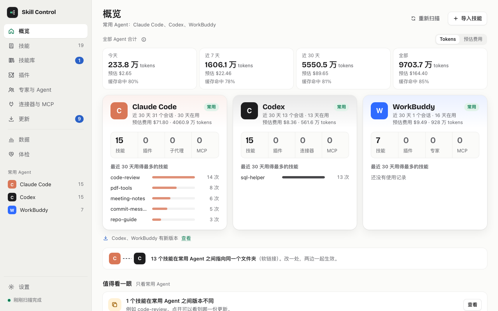
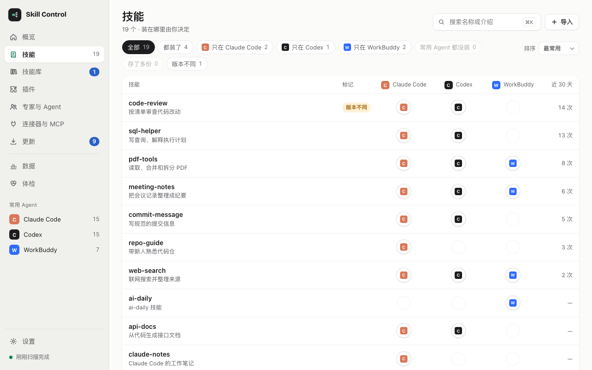
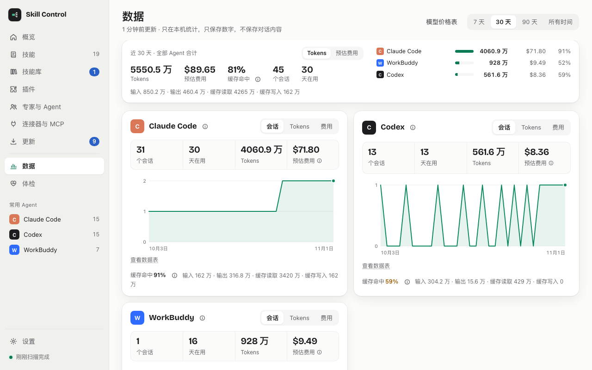
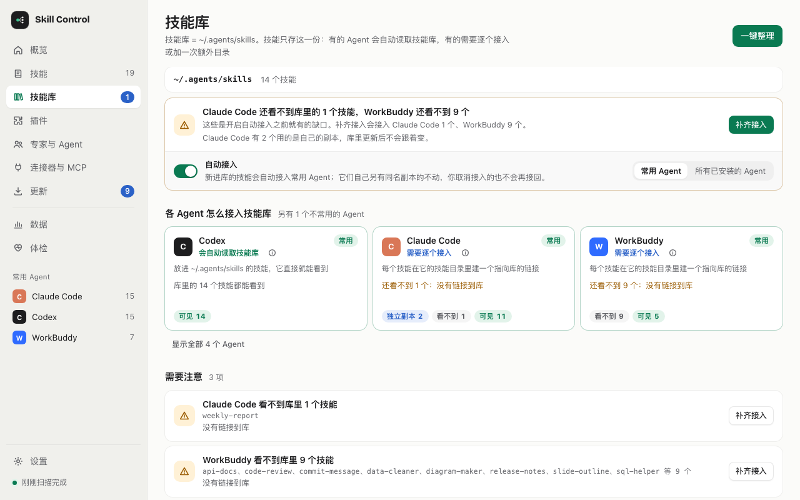

# Skill Control

[简体中文](./README.md) · [English](./README_EN.md)

[](https://github.com/zifeixu85/skill-control/releases/latest)

在一处查看和整理 Codex、Claude Code、WorkBuddy、Hermes、OpenClaw 等 AI Agent 的技能、插件、MCP 和用量；技能装一次，各 Agent 都能用。所有扫描和统计都在本机完成。



## 三步开始

### 1. 下载

| 你的电脑 | 下载这个文件 |
| --- | --- |
| Mac，Apple 芯片（M1、M2、M3、M4 等） | [Skill-Control-mac-arm64.dmg](https://github.com/zifeixu85/skill-control/releases/latest/download/Skill-Control-mac-arm64.dmg) |
| Mac，Intel 芯片 | [Skill-Control-mac-x64.dmg](https://github.com/zifeixu85/skill-control/releases/latest/download/Skill-Control-mac-x64.dmg) |
| Windows 10 / 11（x64） | [Skill-Control-win-x64-setup.exe](https://github.com/zifeixu85/skill-control/releases/latest/download/Skill-Control-win-x64-setup.exe) |
| Linux（x64） | [Skill-Control-linux-x86_64.AppImage](https://github.com/zifeixu85/skill-control/releases/latest/download/Skill-Control-linux-x86_64.AppImage) |

- 不确定 Mac 是哪种芯片：点屏幕左上角的苹果菜单 →“关于本机”。写着“芯片 Apple M…”选第一个，写着“处理器 …Intel…”选第二个。
- Windows 便携版、Linux 的 `.deb` 和历史版本在 [Releases](https://github.com/zifeixu85/skill-control/releases) 页面。那里的 `.zip`、`latest*.yml`、`.blockmap` 是应用内更新用的，不需要下载。

### 2. 第一次打开

- **macOS**：打开 dmg，把 Skill Control 拖进“应用程序”，再双击打开。第一次会被系统拦下，按[首次打开（macOS）](#首次打开macos)操作一次即可。
- **Windows / Linux**：见[首次打开（Windows / Linux）](#首次打开windows--linux)。

### 3. 选常用 Agent

第一次打开有两步：

1. 先说明它会读取什么、只在本机统计、改动先给你看、会联网检查更新。这里可以直接关掉“自动检查更新”。
2. 选你主要用的 Agent（最多 4 个）。有会话记录时，会按最近 30 天的使用情况推荐。技能状态和自动接入都围绕这几个 Agent。

没有检测到 Agent 时：装好其中一个、至少打开过一次，再点“重新检测”。之后可以在“设置 → 常用 Agent”里修改。

## 能做什么

- **技能**：一张表看清每个技能装在哪些 Agent 里、近 30 天用了几次。点空圆点可以装到那个 Agent。同名技能内容不同时，可以查看差异，或用较新的一份更新另一份（先备份）。
- **技能库**：技能只存一份，各 Agent 都能用，见[下一节](#技能库装一次各-agent-都能用)。
- **更新**：检查 Agent 软件、技能和插件有没有新版本；更新前先列出要做的事。
- **数据**：各 Agent、模型和项目的会话数、Token、缓存命中率，以及按官方 API 价格估算的费用。这是估算，订阅内的用量不等于实际账单。
- **体检**：失效链接、缺少的命令和环境变量、配置里的明文密钥等。每一项都可以“复制 AI 指令”交给你自己的 AI 处理；命令行工具的部分问题可以“预览修复”。
- **插件、专家与 Agent、连接器与 MCP、命令行工具、密钥**：看清每个 Agent 装了什么，密钥存在哪里、有没有变化。

除了[自动接入](#技能库装一次各-agent-都能用)，所有改动都先列出每一步，确认后才执行；包括自动接入在内，都可以在“设置 → 历史与撤销”里撤销。

<p>
  
  
</p>

## 技能库：装一次，各 Agent 都能用

技能只在 `~/.agents/skills/<名称>` 放一份，这个目录叫“技能库”。各 Agent 用自己能读的方式接入：

| 接入方式 | Agent | 做了什么 |
| --- | --- | --- |
| 会自动读取技能库 | Codex、Gemini CLI、Cursor、GitHub Copilot、OpenCode、Windsurf、OpenClaw、QClaw | 不用改动，放进库就能看到 |
| 需要逐个接入 | Claude Code、WorkBuddy、Kiro、Trae、CodeBuddy | 在它自己的技能目录里，为每个技能建一个指向库的链接 |
| 通过额外目录读取 | Hermes | 在它的配置里加一次技能库目录；需要你同意，改之前备份 |
| 需要复制一份 | 办公小浣熊 | 它不认链接，每个技能复制一份。库里的技能更新后，这份副本暂时不会自动跟着更新 |

其他 Agent（如 Cline、Roo Code、Qwen Code、订单来了）暂时不读取技能库，仍用它们自己的目录。每个 Agent 的目录和识别方式见[支持的 Agent](./docs/AGENTS-SUPPORT.md)。Windows 上会依次尝试符号链接和目录联接，都不行时复制一份。



**自动接入**（默认开启，开关在技能库页）：新放进技能库的技能，会自动接入你的常用 Agent，也可以改成“所有已安装的 Agent”。

- 只给还没有这个技能的 Agent 接入。Agent 自己已有同名副本的不动，留给“一键整理”由你决定。
- 开启时（包括从旧版本升级后第一次启动），库里已经有的技能先不动。这些缺口在技能库页的“补齐接入”里一次处理：先列出每个 Agent 要接入多少个，确认后执行，可以撤销。
- 不会自动修改 Hermes 的配置。
- 每次自动接入后都会弹出提示，可以直接撤销。撤销过或取消接入的，以后不会再自动接回。

**安装方式**：在“设置 → 安装方式”里选“统一技能库（推荐）”或“各装一份”（复制到每个 Agent 自己的目录）。导入技能（`.skill`、`.zip` 或文件夹）或者从一个 Agent 装到其他 Agent 时，可以选“所有常用 Agent（推荐）”“选择 Agent”或“只装到某个 Agent”（不进技能库）。

**命令行工具和 skill-control 技能**：都在“设置 → Agent 集成”里。

- “安装命令行工具”会写一个小脚本 `~/.local/bin/skill-control`（目前支持 macOS 和 Linux）。它用应用自带的运行环境执行，不打开窗口、不联网，和应用共用备份、历史和撤销。`~/.local/bin` 需要在 PATH 里。

  ```bash
  skill-control status              # 技能库位置、自动接入设置、各 Agent 能不能看到
  skill-control add ./my-skill      # 校验后放进技能库，接入常用 Agent
  skill-control doctor              # 说明哪个 Agent 看不到哪个技能、为什么
  skill-control undo <historyId>    # 撤销一次改动
  ```

  会改东西的命令加 `--dry-run` 只预览；加 `--json` 输出给 Agent 读。完整用法见 `skill-control --help`。
- “skill-control 技能 → 装到常用 Agent”会把随附的 `skill-control` 技能放进技能库并接入。之后在 Agent 里说“装个技能”“从 GitHub 装这个 skill”，它会先问装给哪些 Agent，把来源下载到临时目录做安全检查，再用 `skill-control add` 放进技能库；没装命令行工具时，按手动步骤操作。

设计细节见 [docs/LIBRARY-UPDATES-CLI.md](./docs/LIBRARY-UPDATES-CLI.md)。

## 系统要求

| 系统 | 要求 | 测试情况 |
| --- | --- | --- |
| macOS | 12 或更高，Apple 芯片或 Intel | 主要在这里开发和测试 |
| Windows | Windows 10 / 11，x64 | 测试较少 |
| Linux | x64，AppImage 或 `.deb` | 测试较少。AppImage 的注意事项见[首次打开](#首次打开windows--linux) |

Windows 和 Linux 上还有这些差别：Agent 桌面应用的版本和图标只在 macOS 上识别，“更新 → Agent 软件”只列出命令行版本；命令行工具 `skill-control` 暂不支持 Windows。

## 首次打开

### 首次打开（macOS）

Skill Control 是个人开源项目，没有 Apple 开发者证书（Developer ID），也没有经过 Apple 公证，所以 macOS 第一次打开时会拦下它。按下面做一次，以后就能正常打开。以下以 macOS 15 及以后为例，旧版本的文字略有不同。

1. 打开 dmg，把 Skill Control 拖进“应用程序”文件夹，然后双击打开。
2. 系统弹窗的标题是 未打开“Skill Control”，正文说 Apple无法验证“Skill Control”是否包含可能危害Mac安全或泄漏隐私的恶意软件。点“完成”，不要点“移到废纸篓”。
3. 打开“系统设置 → 隐私与安全性”，滚到“安全性”一节，会看到一行字：已阻止“Skill Control”以保护Mac。在它旁边点“仍要打开”。
4. 系统会再确认一次，按提示输入登录密码或使用触控 ID。

**找不到“仍要打开”**：这个按钮只在被拦下后大约一小时内显示。先再双击一次应用，再回到设置里找。

macOS 14 及更早，也可以在“应用程序”里按住 Control 点按 Skill Control，选“打开”。如果提示“已损坏，无法打开”，那是 v0.2.0 的问题，请下载最新版本。

**签名能说明什么**：从 v0.3.0 起，macOS 版用一张固定的自签名证书签名，证书 SHA-1 是 `313A65FF9080E447216EBC2C090344785D2652B1`。签名能证明应用在签名后没有被改动，并且各个版本出自同一张证书，应用内更新也会核对这一点。它不能证明发布者的身份：这张证书不是 Apple 签发的，应用也没有经过公证，所以 macOS 仍会拦一下。介意的话，可以先核对下载文件，或者[从源码运行](#从源码运行)。

```bash
# 下载文件的 SHA-256，和 Release 里 SHA256SUMS.txt 中同名的一行比较
shasum -a 256 ~/Downloads/Skill-Control-mac-arm64.dmg

# 应用的签名证书：应输出 313a65ff9080e447216ebc2c090344785d2652b1（大小写不影响）
codesign -d --extract-certificates=/tmp/skill-control-cert- "/Applications/Skill Control.app"
shasum -a 1 /tmp/skill-control-cert-0
```

### 首次打开（Windows / Linux）

- **Windows**：安装包没有代码签名，SmartScreen 可能显示“Windows 已保护你的电脑”。点“更多信息”，再点“仍要运行”。
- **Linux**：先给 AppImage 加执行权限再运行：`chmod +x Skill-Control-linux-x86_64.AppImage`。Ubuntu 22.04 及以后要先装 libfuse2（`sudo apt install libfuse2`，Ubuntu 24.04 上包名是 `libfuse2t64`）。Ubuntu 24.04 默认的 AppArmor 设置可能让 Electron 应用的沙箱起不来，导致无法启动；我们还没有在 Linux 上实测这一点，遇到请[反馈](https://github.com/zifeixu85/skill-control/issues)。

### 更新 Skill Control

在“设置 → 版本检查”里检查和安装新版本（只提供正式版本）。macOS 会先校验下载的文件和签名证书，再替换应用并重启，任何一步失败都会恢复原来的版本。如果 macOS 阻止替换，界面会告诉你到“系统设置 → 隐私与安全性 → App管理”里允许 Skill Control，也可以打开下载页手动更新。请把应用放在“应用程序”文件夹里；直接从 dmg 运行时不能应用内更新。Windows 安装版和 Linux AppImage 可以在应用内更新；便携版和 `.deb` 请手动下载新版本。

## 隐私

- 没有遥测、没有账户、没有维护者运营的服务器，不上传任何内容。
- 会读取会话记录文件来统计次数和 Token，只保存数字，不保存、不上传对话内容。
- 不显示、不保存密钥的值，只在本机保存一个加盐指纹，用来判断是否变化。
- 会联网检查更新（GitHub、npm 和各 Agent 应用自己的更新地址），只发出版本查询。可以在“设置 → 数据与隐私”里关掉“自动检查更新”。

读取的每个位置、保存的内容、什么时候改动其他 Agent 的文件夹，见 [PRIVACY.md](./PRIVACY.md)。

## 卸载

1. （可选）在“设置 → Agent 集成”里卸载命令行工具。
2. 退出 Skill Control，删除应用：macOS 把“应用程序”里的 Skill Control 移到废纸篓；Windows 在系统的“应用”设置里卸载（卸载时会保留数据）；Linux 删除 AppImage 文件，或运行 `sudo apt remove skill-control`。
3. （可选）删除数据。先看一眼 `~/.agent-skill-manager/trash/` 和 `backups/`：从 Agent 移除的技能和替换前的旧版本都在里面，删掉就找不回。

   | 位置 | 内容 |
   | --- | --- |
   | `~/.agent-skill-manager/` | 设置、历史、用量统计、备份和回收站 |
   | `~/Library/Application Support/Skill Control/`（Windows `%APPDATA%\Skill Control`，Linux `~/.config/Skill Control`） | 应用更新状态和缓存 |
   | `~/Library/Preferences/dev.skillcontrol.desktop.plist` | macOS 的偏好设置 |
   | `~/.local/bin/skill-control` | 命令行工具。应用已经删了的话，确认文件第二行是 `# skill-control-launcher …` 再删 |

   ```bash
   # macOS：确认不需要 trash/ 和 backups/ 之后再运行
   rm -rf ~/.agent-skill-manager "$HOME/Library/Application Support/Skill Control"
   rm -f ~/Library/Preferences/dev.skillcontrol.desktop.plist
   ```

4. **不要删除技能库 `~/.agents/skills`。** 各 Agent 技能目录里指向它的链接（例如 `~/.claude/skills/<名称>`）在卸载应用后照常可用；删掉技能库，这些链接就会失效。

## 从源码运行

需要 Node.js 22.13.0 或更高版本、npm 和 Git。

```bash
git clone https://github.com/zifeixu85/skill-control.git
cd skill-control
npm install
npm run dev          # 打开 http://localhost:3000
npm run desktop:dev  # 或者用 Electron 开发窗口
```

开发、测试和打包见 [CONTRIBUTING.md](./CONTRIBUTING.md)、[架构说明](./docs/ARCHITECTURE.md) 和[发布指南](./docs/RELEASING.md)。

## 参与贡献

欢迎提交 Bug、交互改进、Agent 适配和安全修复：

- [贡献指南](./CONTRIBUTING.md) · [行为准则](./CODE_OF_CONDUCT.md) · [安全政策](./SECURITY.md)
- [版本记录](./CHANGELOG.md) · [支持的 Agent](./docs/AGENTS-SUPPORT.md) · [架构说明](./docs/ARCHITECTURE.md)
- [第三方声明](./THIRD_PARTY_NOTICES.md) · [发布指南](./docs/RELEASING.md)

## 作者

由 A梦 开发和维护。

- 网站：[ameng.blog](https://ameng.blog)
- 仓库：[github.com/zifeixu85/skill-control](https://github.com/zifeixu85/skill-control)
- 问题与建议：[GitHub Issues](https://github.com/zifeixu85/skill-control/issues)

## 许可证

[MIT License](./LICENSE)
