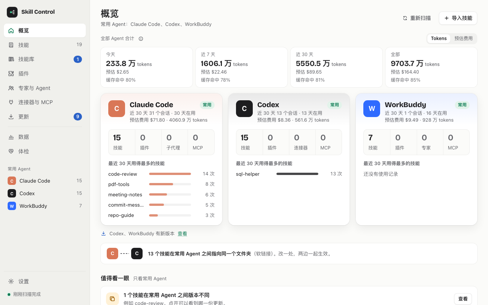
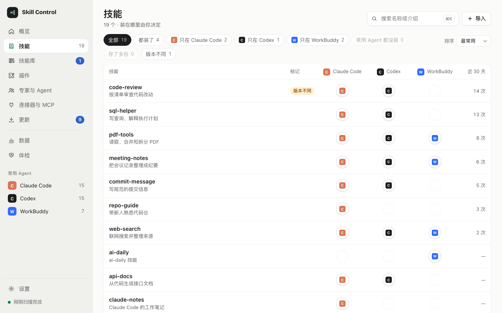
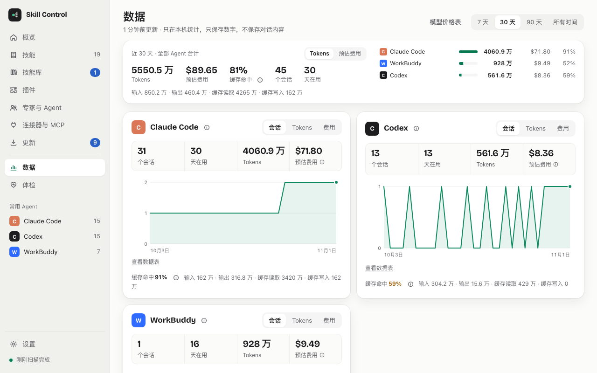
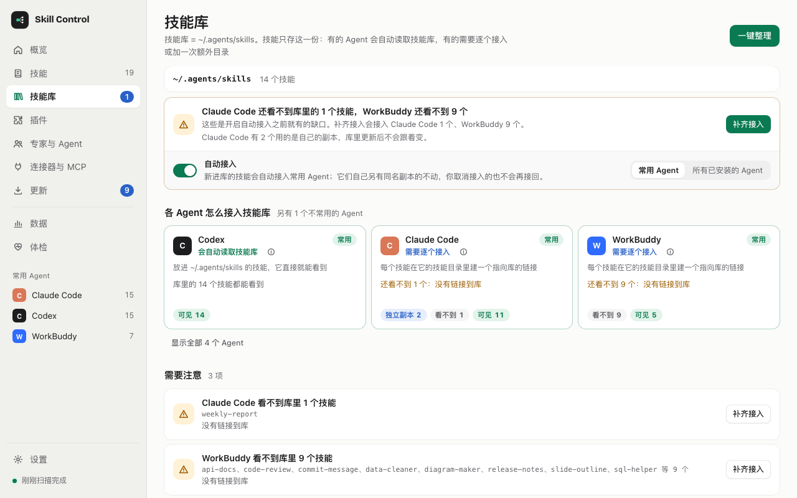

# Skill Control

[简体中文](./README.md) · [English](./README_EN.md)

[](https://github.com/zifeixu85/skill-control/releases/latest)

See and organize the skills, plugins, MCP servers and usage of Codex, Claude Code, WorkBuddy, Hermes, OpenClaw and other AI agents in one place; install a skill once and every agent can use it. All scanning and counting happens on your computer.

> **The app's interface is currently Simplified Chinese only; an English interface is planned for the next release.** Screen and menu names below are given in Chinese with an English translation.



## Get started in three steps

### 1. Download

| Your computer | Download this file |
| --- | --- |
| Mac with Apple silicon (M1, M2, M3, M4 …) | [Skill-Control-mac-arm64.dmg](https://github.com/zifeixu85/skill-control/releases/latest/download/Skill-Control-mac-arm64.dmg) |
| Mac with an Intel processor | [Skill-Control-mac-x64.dmg](https://github.com/zifeixu85/skill-control/releases/latest/download/Skill-Control-mac-x64.dmg) |
| Windows 10 / 11 (x64) | [Skill-Control-win-x64-setup.exe](https://github.com/zifeixu85/skill-control/releases/latest/download/Skill-Control-win-x64-setup.exe) |
| Linux (x64) | [Skill-Control-linux-x86_64.AppImage](https://github.com/zifeixu85/skill-control/releases/latest/download/Skill-Control-linux-x86_64.AppImage) |

- Not sure which Mac you have? Apple menu → About This Mac: "Chip Apple M…" means the first file, "Processor … Intel …" the second.
- The portable Windows build, the Linux `.deb` and older versions are on the [Releases](https://github.com/zifeixu85/skill-control/releases) page. The `.zip`, `latest*.yml` and `.blockmap` files there are for in-app updates; you don't need them.

### 2. Open it the first time

- **macOS**: open the dmg, drag Skill Control into Applications, then double-click it. macOS stops the first launch; follow [First launch on macOS](#first-launch-on-macos) once.
- **Windows / Linux**: see [First launch on Windows / Linux](#first-launch-on-windows--linux).

### 3. Choose your primary agents

The first start has two steps:

1. What Skill Control reads, that it counts only on your computer, that changes are shown before they run, and that it checks for updates online. You can turn off automatic update checks (自动检查更新) right there.
2. Pick the agents you use most (up to four). With session history it suggests agents from the last 30 days. Skill status and auto-link are based on these agents.

If no agent is detected, install one, open it at least once, then click 重新检测 (detect again). You can change your choice later in 设置 → 常用 Agent (Settings → Primary agents).

## What it does

- **Skills (技能)**: one table shows which agents have each skill and how often it was used in the last 30 days. Click an empty dot to install a skill into that agent. When copies with the same name differ, view the differences or update the older copy from the newer one (backed up first).
- **Library (技能库)**: each skill stored once and usable by every agent; see the [next section](#the-skill-library-install-once-use-in-every-agent).
- **Updates (更新)**: new versions of agent software, skills and plugins; every update shows what it will do first.
- **Usage (数据)**: sessions, tokens and cache hit rate by agent, model and project, plus a cost estimate at official API prices. It is an estimate; subscription usage is not your bill.
- **Health (体检)**: broken links, missing commands and environment variables, literal secrets in configuration and more. Each finding has 复制 AI 指令 (copy a prompt for your own AI); some command-line tool problems have 预览修复 (preview fix).
- **Plugins, experts and agents, connectors and MCP, command-line tools, secrets**: what each agent has installed, and where secrets are stored and whether they changed.

Apart from [auto-link](#the-skill-library-install-once-use-in-every-agent), every change lists its steps first and runs only after you confirm; all of them, auto-link included, can be undone in 设置 → 历史与撤销 (Settings → History and undo).

<p>
  
  
</p>

## The skill library: install once, use in every agent

Each skill is stored once, in `~/.agents/skills/<name>`, called the library. Each agent reaches it the way it can:

| How it reads the library | Agents | What Skill Control does |
| --- | --- | --- |
| Reads it natively | Codex, Gemini CLI, Cursor, GitHub Copilot, OpenCode, Windsurf, OpenClaw, QClaw | Nothing; a skill in the library is visible right away |
| Needs a link per skill | Claude Code, WorkBuddy, Kiro, Trae, CodeBuddy | One link per skill in the agent's own skills folder, pointing to the library |
| Reads an extra directory | Hermes | Adds the library to its configuration once, with your consent and a backup |
| Needs a copy | Office Raccoon (办公小浣熊) | It does not follow links, so each skill is copied. When the library copy changes, this copy is not refreshed automatically yet |

Other agents (such as Cline, Roo Code, Qwen Code and SmartOrder) do not read the library yet and keep using their own folders. Folders and detection for every agent are in [Supported agents](./docs/AGENTS-SUPPORT.md). On Windows, Skill Control tries a symbolic link, then a directory junction, then a copy.



**Auto-link** (自动接入, on by default, switch on the library page): a skill that newly arrives in the library is connected to your primary agents automatically; you can widen this to all installed agents.

- Only agents that don't have the skill yet are touched. An agent's own copy with the same name is left alone, for you to decide on in 一键整理 (tidy up).
- When auto-link is turned on (including the first start after upgrading), the skills already in the library are left alone. Those gaps are filled in one go with 补齐接入 (catch-up) on the library page: it lists how many skills each agent will get, runs after you confirm, and can be undone.
- Hermes' configuration is never changed automatically.
- After each auto-link a notice offers undo. Anything you undid or unlinked is never linked again automatically.

**Install mode**: in 设置 → 安装方式 (Settings → Install mode) choose 统一技能库 (shared library, recommended) or 各装一份 (a copy in each agent's own folder). When you import a skill (`.skill`, `.zip` or a folder) or install it from one agent to others, choose all primary agents (recommended), chosen agents, or one agent only (outside the library).

**Command line and the skill-control skill**: both in 设置 → Agent 集成 (Settings → Agent integration).

- 安装命令行工具 (install command-line tool) writes a small script, `~/.local/bin/skill-control` (macOS and Linux for now). It runs with the app's own runtime, opens no window, never goes online, and shares backups, history and undo with the app. `~/.local/bin` must be on your PATH.

  ```bash
  skill-control status              # library location, auto-link settings, which agents can see what
  skill-control add ./my-skill      # check it, put it in the library, connect primary agents
  skill-control doctor              # which agent cannot see which skill, and why
  skill-control undo <historyId>    # undo one change
  ```

  Add `--dry-run` to any command that changes things to preview it, and `--json` for output an agent can read. See `skill-control --help` for the rest. The command's own messages are in Chinese.
- skill-control 技能 → 装到常用 Agent (install to primary agents) puts the bundled `skill-control` skill into the library and connects it. Then, when you ask an agent to "install a skill" or "install this skill from GitHub", it asks which agents should get it, downloads the source to a temporary folder for a safety review, and adds it with `skill-control add`; without the command-line tool it follows manual steps.

Design details: [docs/LIBRARY-UPDATES-CLI.md](./docs/LIBRARY-UPDATES-CLI.md) (Chinese).

## System requirements

| System | Requirement | Testing |
| --- | --- | --- |
| macOS | 12 or later, Apple silicon or Intel | Developed and tested mainly here |
| Windows | Windows 10 / 11, x64 | Less tested |
| Linux | x64, AppImage or `.deb` | Less tested. See [first launch](#first-launch-on-windows--linux) for AppImage notes |

Other differences on Windows and Linux: versions and icons of agents' desktop apps are detected on macOS only, so Updates → Agent software lists command-line versions only; the `skill-control` command line is not available on Windows yet.

## First launch

### First launch on macOS

Skill Control is a personal open-source project. It has no Apple Developer ID and is not notarized by Apple, so macOS stops it the first time. Do this once and it opens normally afterwards. The steps below are for macOS 15 and later; older versions word things slightly differently.

1. Open the dmg, drag Skill Control into Applications, then double-click it.
2. macOS says "Skill Control" Not Opened: Apple could not verify it is free of malware. Click Done, not Move to Trash.
3. Open System Settings → Privacy & Security and scroll to Security, where it says "Skill Control" was blocked to protect your Mac. Click Open Anyway.
4. macOS asks once more; confirm with your login password or Touch ID.

**No Open Anyway button?** It only shows for about an hour after the app was blocked. Double-click the app again, then go back to Settings.

On macOS 14 and earlier you can also Control-click Skill Control in Applications and choose Open. If macOS says the app "is damaged", that was a v0.2.0 problem; download the latest version.

**What the signature tells you**: from v0.3.0 the macOS app is signed with one fixed self-signed certificate, SHA-1 `313A65FF9080E447216EBC2C090344785D2652B1`. The signature shows that the app has not been changed since it was signed and that every version comes from the same certificate; in-app updates check this too. It does not prove who published it: the certificate is not issued by Apple and the app is not notarized, which is why macOS still stops it. If that matters to you, check the download first or [run from source](#run-from-source).

```bash
# SHA-256 of the download; compare with the line for the same file in the release's SHA256SUMS.txt
shasum -a 256 ~/Downloads/Skill-Control-mac-arm64.dmg

# The app's signing certificate: should print 313a65ff9080e447216ebc2c090344785d2652b1 (case doesn't matter)
codesign -d --extract-certificates=/tmp/skill-control-cert- "/Applications/Skill Control.app"
shasum -a 1 /tmp/skill-control-cert-0
```

### First launch on Windows / Linux

- **Windows**: the installer is not code-signed, so SmartScreen may say "Windows protected your PC". Click More info, then Run anyway.
- **Linux**: make the AppImage executable first: `chmod +x Skill-Control-linux-x86_64.AppImage`. Ubuntu 22.04 and later need libfuse2 (`sudo apt install libfuse2`; on Ubuntu 24.04 the package is `libfuse2t64`). Ubuntu 24.04's default AppArmor settings may stop the Electron sandbox from starting, so the app may not open; we have not tested this on Linux yet, so please [report it](https://github.com/zifeixu85/skill-control/issues) if it happens.

### Updating Skill Control

Check for and install new versions in 设置 → 版本检查 (Settings → Version checks); only full releases are offered. On macOS the download and its signing certificate are checked before the app is replaced and restarted, and any failure restores the previous version. If macOS blocks the replacement, the app explains how to allow Skill Control in System Settings → Privacy & Security → App Management, or opens the download page. Keep the app in Applications; run from the dmg it cannot update itself. The Windows installer build and the Linux AppImage update in place; for the portable build and the `.deb`, download the new version yourself.

## Privacy

- No telemetry, no account, no server run by the maintainers; nothing is uploaded.
- Session files are read to count sessions and tokens. Only numbers are kept; conversation content is never stored or uploaded.
- Secret values are never shown or stored; only a salted fingerprint is kept on your computer, to tell whether a value changed.
- Update checks go online (GitHub, npm and each agent app's own update address) and send only version queries. Turn them off in 设置 → 数据与隐私 → 自动检查更新 (Settings → Data and privacy → Automatic update checks).

Every location read, what is kept, and when other agents' folders are changed: [PRIVACY.md](./PRIVACY.md#english).

## Uninstall

1. (Optional) Remove the command-line tool in 设置 → Agent 集成.
2. Quit Skill Control and remove the app: on macOS move it from Applications to the Trash; on Windows uninstall it in Settings → Apps (its data is kept); on Linux delete the AppImage or run `sudo apt remove skill-control`.
3. (Optional) Delete its data. Look inside `~/.agent-skill-manager/trash/` and `backups/` first: skills removed from agents and replaced old versions are kept there and cannot be recovered once deleted.

   | Location | Contents |
   | --- | --- |
   | `~/.agent-skill-manager/` | Settings, history, usage counts, backups and the trash |
   | `~/Library/Application Support/Skill Control/` (Windows `%APPDATA%\Skill Control`, Linux `~/.config/Skill Control`) | App update state and caches |
   | `~/Library/Preferences/dev.skillcontrol.desktop.plist` | macOS preferences |
   | `~/.local/bin/skill-control` | The command-line tool. If the app is already gone, check that the file's second line is `# skill-control-launcher …` before deleting it |

   ```bash
   # macOS: run only once you no longer need trash/ and backups/
   rm -rf ~/.agent-skill-manager "$HOME/Library/Application Support/Skill Control"
   rm -f ~/Library/Preferences/dev.skillcontrol.desktop.plist
   ```

4. **Do not delete the library `~/.agents/skills`.** The links to it in your agents' skill folders (for example `~/.claude/skills/<name>`) keep working after the app is gone; deleting the library breaks them.

## Run from source

Requires Node.js 22.13.0 or later, npm and Git.

```bash
git clone https://github.com/zifeixu85/skill-control.git
cd skill-control
npm install
npm run dev          # then open http://localhost:3000
npm run desktop:dev  # or an Electron development window
```

For development, tests and packaging see [CONTRIBUTING.md](./CONTRIBUTING.md), the [architecture notes](./docs/ARCHITECTURE.md) and the [release guide](./docs/RELEASING.md).

## Contributing

Bug reports, interaction improvements, agent adapters and security fixes are welcome:

- [Contributing guide](./CONTRIBUTING.md) · [Code of Conduct](./CODE_OF_CONDUCT.md) · [Security policy](./SECURITY.md)
- [Changelog](./CHANGELOG.md) · [Supported agents](./docs/AGENTS-SUPPORT.md) · [Architecture](./docs/ARCHITECTURE.md)
- [Third-party notices](./THIRD_PARTY_NOTICES.md) · [Release guide](./docs/RELEASING.md)

## Author

Built and maintained by A梦.

- Website: [ameng.blog](https://ameng.blog)
- Repository: [github.com/zifeixu85/skill-control](https://github.com/zifeixu85/skill-control)
- Problems and ideas: [GitHub Issues](https://github.com/zifeixu85/skill-control/issues)

## License

[MIT License](./LICENSE)
